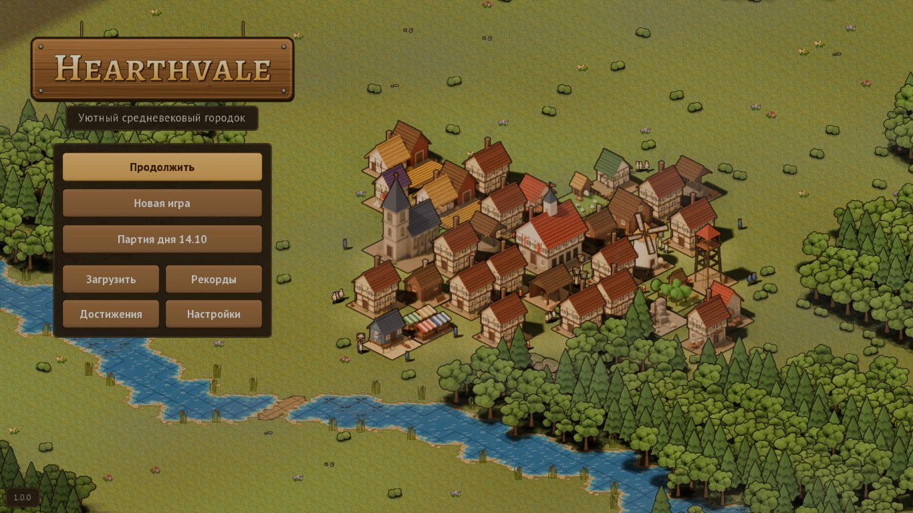

# Hearthvale

### Уютный средневековый город, который живёт сам

*A cozy medieval town that lives on its own*

**Бесплатно · без рекламы · без покупок · RU / EN**
*Free · no ads · no purchases*

[Русский](#русский) · [English](#english)

---

## Русский

### Каждое бревно несёт живой житель

В Hearthvale нет волшебных складов и таймеров. Лесоруб валит дерево, носильщик несёт брёвна на лесопилку, оттуда доски уходят на стройку, а хлеб из пекарни - прямо к дверям домов. Вы видите, кто, что и куда несёт, и каждую улицу проектируете так, чтобы город дышал.

Начните с ратуши и пары домиков у реки - и вырастите шумную столицу с собором, замком и ярмарками.

### Почему в это хочется играть

- **Город, за которым интересно наблюдать.** Сотни жителей с собственным распорядком: утром на работу, днём с ношей по дорогам, вечером домой, где в окнах загорается свет.
- **Настоящие цепочки производства.** Пшеница - мука - хлеб, руда и уголь - железо - инструменты, шерсть - ткань, мёд и воск - свечи. Поставите мастерскую далеко от сырья - и город сразу это почувствует.
- **Смена сезонов.** Весной разливается река, летом созревают поля, осенью желтеет лес, а зимой на крышах лежит снег, деревья стоят голые и каждому дому нужны дрова.
- **Жизнь с характером.** Дождь и засуха, паводки, пожары и болезни, волки из леса и разбойники с дорог. Караульные вышки, стены, каланча и лекарь берегут город.
- **Город растёт вместе с вами.** Восемь уровней - от хутора до столицы. Дети взрослеют и после школы работают быстрее, соседние сёла заключают договоры, корона шлёт заказы.
- **Без стресса.** Пауза в любой момент, скорости 1x / 3x / 10x, отмена, перенос здания без простоя. Если мастерская стоит, игра скажет почему и предложит решение одной кнопкой.

### Чем заняться

- **Кампания** на карте королевства: обучение и ещё шесть историй, от «Долгой зимы» до «Весны на реке», со звёздами за скорость.
- **Песочница** на бесконечном числе карт. Карту можно передать другу коротким кодом.
- **Партия дня** - одна карта на всех, рекорды и почти сорок достижений.

**50 зданий · 25 товаров · 8 уровней города · 7 сценариев · 4 сезона**

### Как это выглядит

| | |
|:-:|:-:|
|  |  |
| Город живёт даже на заглавном экране | Зима: снег, дрова и голые деревья |
|  |  |
| Всё о городе - в одной панели | Подробная статистика и графики |

*Удобно и на телефоне: стоя и лёжа*

### Где играть

- **В браузере** - откройте [wiverhome.github.io/hearthvale](https://wiverhome.github.io/hearthvale/) и играйте сразу, без установки.
- **Android** - скачайте APK со страницы [Releases](https://github.com/WiverHome/hearthvale/releases/latest).
- **iPhone и iPad** - откройте игру в Safari, нажмите «Поделиться» -> «На экран Домой». Hearthvale появится иконкой, откроется на весь экран и будет работать даже без интернета.
- **ПК** - в любом браузере, с подсказками при наведении и горячими клавишами.

Сохранения хранятся на вашем устройстве; партию можно выгрузить в файл и открыть на другом.

---

## English

### Every log is carried by a living citizen

Hearthvale has no magic warehouses and no timers. A woodcutter fells a tree, a carrier hauls the logs to the sawmill, the planks go to the building site and the bread from the bakery goes straight to people's doors. You see who carries what and where, and you shape every street so your town can breathe.

Start with a town hall and a couple of cottages by the river - and grow a bustling capital with a cathedral, a castle and fairs.

### Why you'll love it

- **A town worth watching.** Hundreds of citizens with their own routine: off to work in the morning, hauling goods along the roads by day, home in the evening as the windows light up.
- **Real production chains.** Wheat - flour - bread, ore and coal - iron - tools, wool - cloth, honey and wax - candles. Put a workshop far from its supplies and the whole town feels it.
- **Changing seasons.** The river floods in spring, fields ripen in summer, woods turn gold in autumn, and in winter snow covers the roofs, the trees stand bare and every home needs firewood.
- **A world with character.** Rain and drought, floods, fires and sickness, wolves from the woods and bandits from the roads. Guard towers, walls, a fire watch and a healer keep your town safe.
- **A town that grows with you.** Eight levels, from hamlet to capital. Children grow up and work faster after school, neighbouring villages sign contracts, the crown sends orders.
- **No stress.** Pause at any time, 1x / 3x / 10x speed, undo, move buildings without downtime. If a workshop stands idle, the game tells you why and offers a one-tap fix.

### Ways to play

- **Campaign** on a map of the realm: a tutorial and six more stories, from "The long winter" to "Spring on the river", with stars for speed.
- **Sandbox** on endless maps. Share any map with a friend as a short code.
- **Daily game** - one map for everyone, records and nearly forty achievements.

**50 buildings · 25 goods · 8 town levels · 7 scenarios · 4 seasons**

### Where to play

- **In the browser** - open [wiverhome.github.io/hearthvale](https://wiverhome.github.io/hearthvale/) and play right away, nothing to install.
- **Android** - download the APK from [Releases](https://github.com/WiverHome/hearthvale/releases/latest).
- **iPhone and iPad** - open the game in Safari, tap Share -> Add to Home Screen. Hearthvale gets its own icon, runs full screen and works even offline.
- **PC** - in any browser, with hover tips and hotkeys.

Saves stay on your device; you can export a game to a file and open it on another one.

---

**Условия / Terms.** Игра бесплатная / The game is free to play. Код / Code: [PolyForm Strict 1.0.0](LICENSE) - исходники можно читать, но не распространять, менять и использовать в коммерции / source available to read; no distribution, changes or commercial use. Графика, звуки и музыка / Art, sounds and music: [CC BY-NC 4.0](LICENSE-ASSETS.txt). Название «Hearthvale», вывеска и иконка - все права защищены / the name, title sign and icon - all rights reserved. Шрифты и библиотеки / Fonts and libraries: [NOTICE](assets/licenses/NOTICE.txt), происхождение графики / art origin: [CREDITS](assets/CREDITS.md). Код со стороны не принимается, идеи и ошибки - в [Issues](https://github.com/WiverHome/hearthvale/issues) / outside code is not accepted, ideas and bug reports are welcome in Issues.

