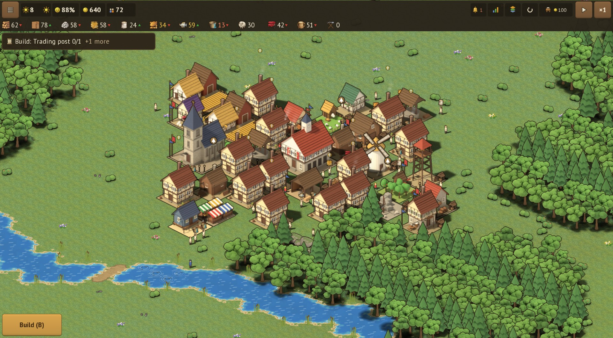
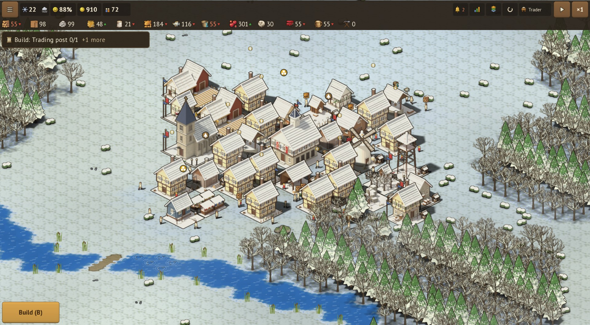
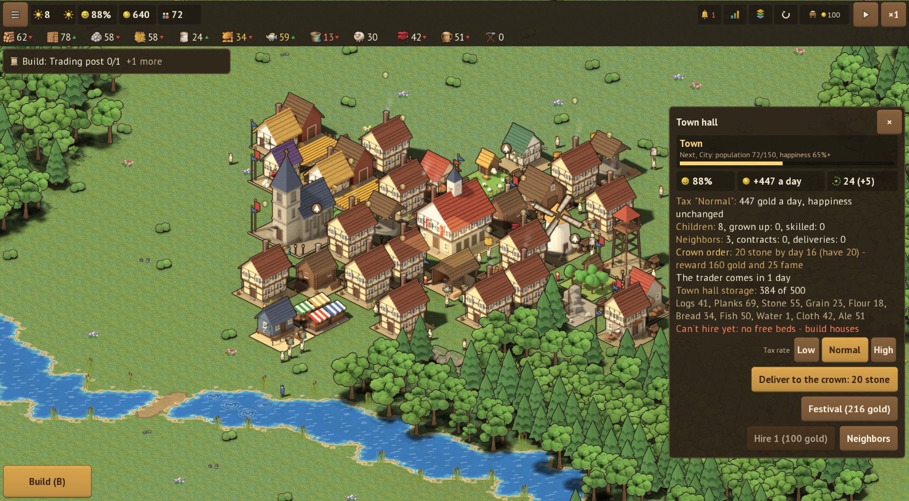
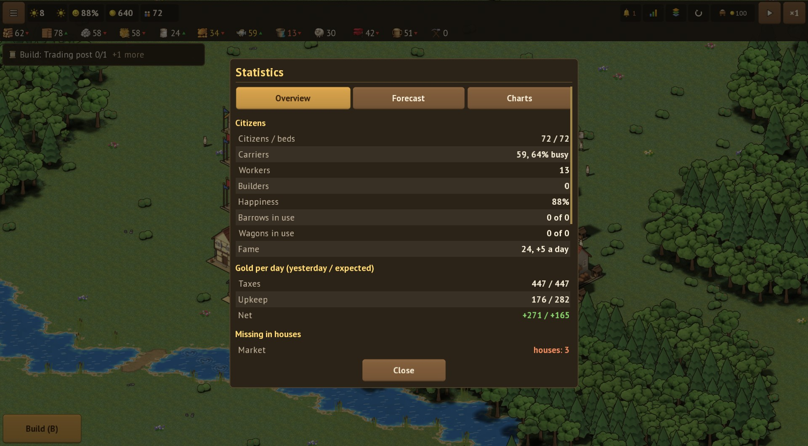
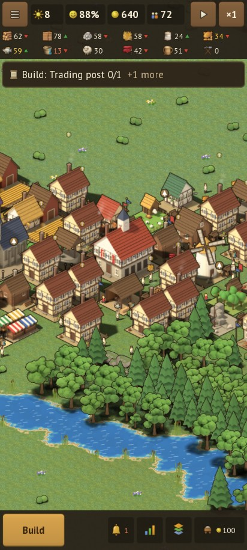

<div align="center">

# Hearthvale

**Уютный средневековый градостроитель, где каждое бревно несёт живой житель**
*A cozy medieval town builder where every log is carried by a living citizen*

[](https://wiverhome.github.io/hearthvale/)
[](https://github.com/WiverHome/hearthvale/releases/latest)




[Русский](#русский) · [English](#english)

</div>

---

## Русский

Hearthvale - градостроитель в духе Townsmen. Здесь нет таймеров и волшебных складов: носильщики носят каждый ресурс от лесоруба к лесопилке, от мельницы к пекарне, от склада к дому. Чем дальше друг от друга звенья цепочки, тем медленнее она работает, так что планировка города и есть главная задача.

Игра бесплатная, без рекламы и покупок. Работает в браузере, на Android и на ПК, на русском и английском.

**iPhone и iPad, без интернета:** откройте https://wiverhome.github.io/hearthvale/ в Safari, нажмите «Поделиться» -> «На экран Домой». Игра появится иконкой, откроется на весь экран и после первого запуска работает без сети; сохранения хранятся на телефоне.

### Возможности
- **Живая экономика.** Носильщики, рабочие и строители, у всех свой распорядок дня. Сырьё подвозится к мастерским, готовое увозится на склады, товары доставляются в дома.
- **Цепочки производства.** Лес -> доски, пшеница -> мука -> хлеб, рыба, вода, дичь, яблоки, шерсть -> ткань, эль; руда и уголь -> железо -> инструменты, шкуры -> кожа -> одежда, свинина -> копчёности, мёд и воск -> свечи. Камень для построек, дороги ускоряют ходьбу вдвое.
- **Потребности домов.** Еда, вода, дрова зимой, рынок, церковь, одежда, таверна. Довольные жители платят налоги, а дома растут от деревянного к каменному.
- **Угрозы.** Зимой из леса выходят волки, с края карты - разбойники; против них караульные вышки и стены. Можно выключить.
- **Сезоны, погода и бедствия.** Зимой поля стоят и нужны дрова. Каждый день своя погода: дождь ускоряет поля, но замедляет носильщиков, засуха сушит поля и колодцы; весной река разливается и заливает пойму, зато земля после этого плодороднее. Случаются пожары (рядом поможет каланча), болезни (лекарь), неурожай и суровая зима.
- **Дети и школа.** В довольных домах рождаются дети; выросшие у школы работают быстрее.
- **Соседи.** Сёла за краем карты: договоры через торговый пост, повозки раз в неделю, отношения растут от поставок в срок.
- **Уровни города и своя земля.** От хутора до города, с каждым уровнем открываются новые здания; землю под стройку расширяют склады, смотровые вышки, церковь и каланча.
- **Удобное управление.** Пауза с планированием, скорости 1x/3x/10x, перенос здания без простоя, отмена, лимиты производства, значок «почему простаивает», поворот здания при постановке, улучшение всех таких же разом, статистика за сутки и окно «Дела в городе» с бедами города прямо сейчас; праздники и «достроить за золото» для богатого города.
- **Режимы и цели.** Кампания на карте королевства (обучение, «Долгая зима», «Торговый перекрёсток», «Пограничье», «Рудный край», «Ярмарка», «Весна на реке» - по порядку, со звёздами за запас времени), песочница на случайной карте по сиду с лентой заданий и настройками (богатство ресурсов, стартовый запас, частота бедствий, спокойный режим), партия дня; достижения, итоги партии с графиками, город растёт до столицы с собором и замком.

### Скриншоты
| | |
|:-:|:-:|
|  |  |
| Зима: снег, дрова, голодные дома | Панель здания |
|  |  |
| Статистика за сутки | На телефоне |

### Управление
| | ПК | Телефон |
|---|---|---|
| Камера | мышь, колесо, WASD / стрелки | палец, щипок |
| Постройка | 1..0 - карточки, R - дорога, клик | карточка, касание, второе касание |
| Отмена | Esc / правая кнопка, Ctrl+Z - последняя постройка | «Назад» |
| Время | пробел - пауза, + / - скорость | кнопки наверху |

### Сборка
Нужен JDK 17. Игра целиком в `core/`, лаунчеры в `web/`, `android/` и `desktop/`.

```bash
./gradlew :core:test                    # тесты симуляции: детерминизм, сохранения, повторы
./gradlew :desktop:run                  # ПК-версия
./gradlew :web:gdx_teavm_web_js_run     # веб на http://localhost:8080
./gradlew :android:assembleDebug        # APK для отладки
./gradlew :tools:run                    # перерисовать атлас, иконки, звуки и музыку
```

План и история: [ROADMAP.md](ROADMAP.md).

---

## English

Hearthvale is a town builder in the spirit of Townsmen. No timers, no magic warehouses: carriers walk every resource from the woodcutter to the sawmill, from the mill to the bakery, from storage to the homes. The farther apart the links of a chain are, the slower it runs, so the layout of your town is the real puzzle.

Free, no ads, no purchases. Runs in the browser, on Android and on PC, in English and Russian.

**iPhone and iPad, offline:** open https://wiverhome.github.io/hearthvale/ in Safari, tap Share -> Add to Home Screen. The game gets an icon, runs full screen and works without a connection after the first launch; saves stay on the device.

### Features
- **A living economy.** Carriers, workers and builders with a daily routine. Raw materials are brought to workshops, goods are taken to storage and delivered to homes.
- **Production chains.** Logs -> planks, wheat -> flour -> bread, fish, water, game, apples, wool -> cloth, ale. Stone for construction, and roads double walking speed.
- **House needs.** Food, water, firewood in winter, market, church, clothing, tavern. Happy citizens pay taxes and homes upgrade from timber to stone.
- **Threats.** Wolves come out of the woods in winter and bandits from the map edge; guard towers and walls keep them out. Can be turned off.
- **Seasons, weather and disasters.** Fields rest in winter and homes need firewood. Every day has its weather: rain speeds up fields but slows carriers, drought dries out fields and wells; in spring the river floods the low ground, which then becomes more fertile. Fires (a fire watch nearby helps), sickness (a healer), bad harvests and harsh winters.
- **Children and school.** Happy homes have children; those who grow up near a school work faster.
- **Neighbours.** Villages beyond the map edge: contracts through a trading post, weekly wagons, relations grow with on-time deliveries.
- **Town levels and land.** From hamlet to city, each level unlocks new buildings; storehouses, watchtowers, the church and the fire watch claim more land to build on.
- **Quality of life.** Pause and plan, 1x/3x/10x speed, move buildings without downtime, undo, production limits, "why is it idle" icons, rotate buildings while placing, upgrade all alike at once, daily statistics and a "Town status" window with current troubles; festivals and "finish for gold" for a rich town.
- **Modes.** A campaign on a map of the realm (tutorial, "The long winter", "Trading crossroads", "The frontier", "Ore country", "The fair", "Spring on the river" - in order, with stars for finishing early), a seeded sandbox with a stream of quests and settings (resource richness, starting stock, disaster frequency, peaceful mode), and a daily game; achievements, an end-of-game summary with charts, a town that grows into a capital with a cathedral and a castle.

### Controls
| | PC | Phone |
|---|---|---|
| Camera | mouse, wheel, WASD / arrows | drag, pinch |
| Build | 1..0 - cards, R - road, click | card, tap, tap again |
| Cancel | Esc / right click, Ctrl+Z - undo last build | Back |
| Time | Space - pause, + / - speed | top bar buttons |

### Building from source
JDK 17 is required. The whole game lives in `core/`; launchers are in `web/`, `android/` and `desktop/`.

```bash
./gradlew :core:test                    # simulation tests: determinism, saves, replays
./gradlew :desktop:run                  # PC version
./gradlew :web:gdx_teavm_web_js_run     # web at http://localhost:8080
./gradlew :android:assembleDebug        # debug APK
./gradlew :tools:run                    # regenerate the atlas, icons, sounds and music
```

---

## Лицензии / Licenses

Игра бесплатная: веб-версия и APK из Releases - играйте сколько угодно. Исходники открыты для чтения, но это не свободная лицензия. / The game is free to play: the web version and the APKs in Releases. The source is available to read, but it is not an open-source license.

- **Код / Code:** [PolyForm Strict 1.0.0](LICENSE) - можно читать, собирать и запускать для себя в некоммерческих целях; нельзя распространять, изменять и делать на его основе свои работы / you may read, build and run it for noncommercial purposes; you may not distribute it, change it or make new works based on it.
- **Графика, звуки, музыка / Art, sounds, music:** [CC BY-NC 4.0](LICENSE-ASSETS.txt) - можно использовать в некоммерческих проектах с указанием «Hearthvale by WiverHome» / you may use them in noncommercial projects with attribution "Hearthvale by WiverHome". Здания, жители и природа - рендер процедурных моделей Blender (`tools/blender`), значки, звуки и музыка - кодом проекта (`tools/`), фактура земли, значки ресурсов и иконка приложения - ИИ-генератор SDXL Turbo (Stability AI Community License, картинки принадлежат проекту) / buildings, citizens and nature are procedural Blender renders, icons, sounds and music are made by the project's code, ground textures, resource icons and the app icon were generated with SDXL Turbo (Stability AI Community License; the images belong to the project). Подробно / details: [assets/CREDITS.md](assets/CREDITS.md).
- **Название, вывеска и иконка / Name, title sign and icon:** «Hearthvale», вывеска заглавного экрана и иконка приложения не лицензируются - все права защищены / are not licensed - all rights reserved.
- **Версии до 1.0.0 / Versions before 1.0.0** выходили на других условиях; эти условия действуют с 1.0.0 / were published under other terms; these terms apply from 1.0.0.
- **Предложения / Contributions:** код со стороны не принимается; идеи и ошибки - в Issues / outside code is not accepted; ideas and bug reports are welcome in Issues.
- **Шрифты / Fonts:** PT Sans, ParaType - [SIL Open Font License 1.1](assets/fonts/OFL.txt); Alegreya SC (только картинка вывески / title sign picture only) - [OFL 1.1](tools/fonts/AlegreyaSC-OFL.txt).
- **Библиотеки / Libraries:** libGDX, gdx-teavm, TeaVM, Kotlin (Apache 2.0), FreeType (FTL), howler.js (MIT), LWJGL (BSD) - [assets/licenses/NOTICE.txt](assets/licenses/NOTICE.txt). Этот же список есть в игре: Настройки -> Об игре / The same list is in the game: Settings -> About.
